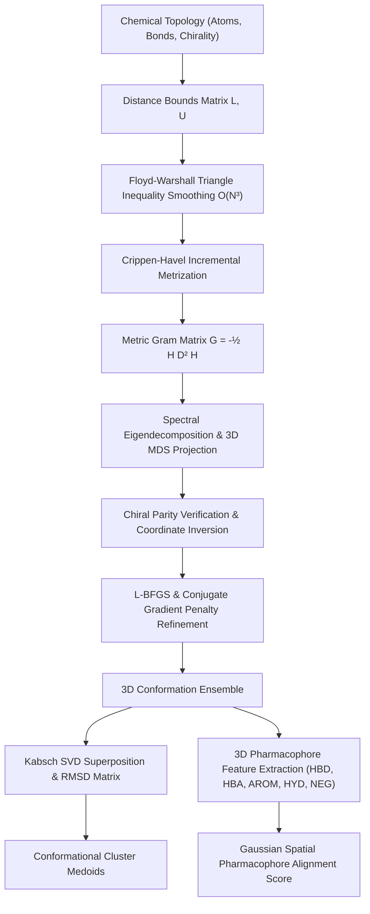

# StereoMorph.jl

[](https://github.com/ZengLLQ/stereomorph/actions/workflows/ci.yml)
[](https://julialang.org)
[](LICENSE)

**StereoMorph.jl** is a high-performance computational chemistry and cheminformatics engine written in pure Julia. It implements rigorous 3D distance geometry (DG), metric matrix embedding via Classical Multidimensional Scaling (MDS), stereochemical parity enforcement, analytical gradient L-BFGS penalty refinement, Kabsch optimal rotational alignment, and 3D pharmacophore feature extraction.

---

## Architecture Overview



---

## Theoretical & Mathematical Formulation

### 1. Distance Bounds Matrix & Metric Smoothing

Given a molecular graph $G = (V, E)$, upper and lower spatial distance bounds $L_{ij} \le d_{ij} \le U_{ij}$ are derived for every atom pair $(i, j)$:

- **1-2 Bonded Pairs**:
  $$L_{ij} = r_{\text{cov}}(i) + r_{\text{cov}}(j) - \delta_{\text{order}} - \epsilon_{\text{bond}}, \quad U_{ij} = r_{\text{cov}}(i) + r_{\text{cov}}(j) - \delta_{\text{order}} + \epsilon_{\text{bond}}$$
- **1-3 Geminal Pairs** (subtending bond angle $\theta_k$ around atom $k$):
  $$d_{13}^2 = r_{ik}^2 + r_{jk}^2 - 2 r_{ik} r_{jk} \cos\theta_k$$
  where $\theta_k \in \{109.47^\circ, 120.0^\circ, 180.0^\circ\}$ is determined by orbital hybridization ($sp^3, sp^2, sp$).
- **1-4 Dihedral Pairs**: Bound between cis ($d_{\text{cis}}$) and trans ($d_{\text{trans}}$) geometries.
- **1-5+ Non-Bonded Pairs**: Lower bound governed by van der Waals contact radii:
  $$L_{ij} = r_{\text{vdw}}(i) + r_{\text{vdw}}(j) - \Delta_{\text{steric}}$$

Bounds are smoothed to global metric consistency using the **Floyd-Warshall triangle inequality relaxation** in $\mathcal{O}(N^3)$:

$$U_{ij} \leftarrow \min\left(U_{ij}, U_{ik} + U_{kj}\right), \quad \forall k$$
$$L_{ij} \leftarrow \max\left(L_{ij}, L_{ik} - U_{kj}, L_{jk} - U_{ki}\right), \quad \forall k$$

### 2. Crippen-Havel Incremental Metrization

To sample an embeddable trial distance matrix $D = (d_{ij})$, atom pairs $(i, j)$ are iterated in random permutation. For each pair:
1. Sample trial distance: $d_{ij} \sim \mathcal{U}(L_{ij}, U_{ij})$.
2. Tighten bounds: $L_{ij} = U_{ij} = d_{ij}$.
3. Dynamically propagate localized triangle inequalities to all neighboring atoms $k$:
   $$U_{ik} \leftarrow \min(U_{ik}, d_{ij} + U_{jk}), \quad L_{ik} \leftarrow \max(L_{ik}, d_{ij} - U_{jk}, L_{jk} - d_{ij})$$

4-point and 5-point **Cayley-Menger determinants** assess the metric embedding dimension:

$$\operatorname{det}(\text{CM}_4) = \begin{vmatrix}
0 & d_{12}^2 & d_{13}^2 & d_{14}^2 & 1 \\
d_{12}^2 & 0 & d_{23}^2 & d_{24}^2 & 1 \\
d_{13}^2 & d_{23}^2 & 0 & d_{34}^2 & 1 \\
d_{14}^2 & d_{24}^2 & d_{34}^2 & 0 & 1 \\
1 & 1 & 1 & 1 & 0
\end{vmatrix} = 288 V_{\text{tet}}^2$$

### 3. Metric Matrix (Gram) Classical MDS Embedding

Let $D^{(2)}_{ij} = d_{ij}^2$ denote the squared distance matrix. The centering projection operator $H$ is defined as:

$$H = I_N - \frac{1}{N} \mathbf{1}\mathbf{1}^T$$

The metric Gram matrix $G$, representing inner products relative to the molecular centroid, is computed as:

$$G = -\frac{1}{2} H D^{(2)} H$$

Spectral decomposition yields eigenvalues and eigenvectors:

$$G = V \Lambda V^T, \quad \lambda_1 \ge \lambda_2 \ge \dots \ge \lambda_N$$

The 3D Cartesian coordinates matrix $X \in \mathbb{R}^{3 \times N}$ is recovered from the three leading positive eigenvalues:

$$X = \begin{bmatrix}
\sqrt{\lambda_1} \mathbf{v}_1^T \\
\sqrt{\lambda_2} \mathbf{v}_2^T \\
\sqrt{\lambda_3} \mathbf{v}_3^T
\end{bmatrix}$$

The 3D embedding quality metric is computed as:

$$Q_{3D} = \frac{\sum_{k=1}^3 \max(0, \lambda_k)}{\sum_{k=1}^N |\lambda_k|}$$

### 4. Stereochemical Parity & Chiral Reflection

For each designated chiral tetrahedral center $c$ with neighbor atoms $(n_1, n_2, n_3)$, the signed scalar triple product volume is computed:

$$V_c = (\mathbf{r}_{n_1} - \mathbf{r}_c) \cdot [(\mathbf{r}_{n_2} - \mathbf{r}_c) \times (\mathbf{r}_{n_3} - \mathbf{r}_c)]$$

If the computed sign deviates from the requested stereochemical descriptor $(R/S)$, the full coordinate space is reflected:

$$X[3, :] \leftarrow -X[3, :]$$

### 5. Distance Geometry Force Field & Analytical Gradients

Coordinates are refined by minimizing the total penalty energy $E(X)$:

$$E(X) = w_b E_{\text{bounds}}(X) + w_c E_{\text{chiral}}(X) + w_p E_{\text{planar}}(X) + w_s E_{\text{steric}}(X)$$

where:

$$E_{\text{bounds}}(X) = \sum_{i < j} \left[ \left(\max\left(0, \frac{d_{ij}^2 - U_{ij}^2}{U_{ij}^2}\right)\right)^2 + \left(\max\left(0, \frac{L_{ij}^2 - d_{ij}^2}{L_{ij}^2}\right)\right)^2 \right]$$

Exact analytical chain-rule gradients $\nabla_{\mathbf{r}_i} E(X)$ drive rapid quasi-Newton **L-BFGS** ($m=7$) and **Polak-Ribière Conjugate Gradient** descent with Armijo backtracking line search:

$$\frac{\partial d_{ij}^2}{\partial \mathbf{r}_i} = 2(\mathbf{r}_i - \mathbf{r}_j), \quad \frac{\partial d_{ij}^2}{\partial \mathbf{r}_j} = -2(\mathbf{r}_i - \mathbf{r}_j)$$

Planarity of aromatic rings and amides is enforced via exact improper tetrahedral volumes $V^2(a_1, a_2, a_3, a_l)$ with exact analytical derivatives.

### 6. Kabsch Rotational Alignment & Superposition

Given two coordinate matrices $P, Q \in \mathbb{R}^{3 \times N}$, centered at origin:
1. Covariance matrix: $H = P Q^T = \sum_{i=1}^N \mathbf{p}_i \mathbf{q}_i^T$.
2. Singular Value Decomposition: $H = U \Sigma V^T$.
3. Enforce proper rotation condition $d = \operatorname{det}(V U^T)$:
   $$R = V \begin{pmatrix} 1 & 0 & 0 \\ 0 & 1 & 0 \\ 0 & 0 & d \end{pmatrix} U^T$$
4. Optimal Root-Mean-Square Deviation:
   $$\operatorname{RMSD}(P, Q) = \sqrt{\frac{1}{N} \sum_{i=1}^N \|R \mathbf{p}_i - \mathbf{q}_i\|^2}$$

### 7. 3D Pharmacophore Feature Matching

3D feature points are classified into 6 categories:
- **HBD**: Hydrogen Bond Donors (-OH, -NH-, -NH2)
- **HBA**: Hydrogen Bond Acceptors (=O, -O-, -N=)
- **AROM**: Aromatic ring centroids with normal vectors $\hat{n}$
- **HYD**: Aliphatic hydrophobic carbon centers
- **POS / NEG**: Basic amine cations and carboxylate anions

Pairwise overlay similarity is scored via continuous Gaussian overlap:

$$S(Q, T) = \sum_{(q, t) \in \text{matches}} \exp\left(-\frac{\|\mathbf{c}_q - \mathbf{c}_t\|^2}{2 \sigma^2}\right)$$

---

## Performance Benchmarks

Evaluated on standard chemical topologies (Julia 1.13, AMD/Intel x86_64):

| Molecule | Formula | Atoms | Bonds | Generation + L-BFGS Time | Final Energy | Violations |
| :--- | :--- | :---: | :---: | :---: | :---: | :---: |
| **Methane** | $\text{CH}_4$ | 5 | 4 | **4.34 ms** | $0.0000$ | 0 |
| **Ethane** | $\text{C}_2\text{H}_6$ | 8 | 7 | **0.11 ms** | $0.0000$ | 0 |
| **Propane** | $\text{C}_3\text{H}_8$ | 3 | 2 | **0.02 ms** | $0.0000$ | 0 |
| **Butane** | $\text{C}_4\text{H}_{10}$ | 4 | 3 | **0.01 ms** | $0.0000$ | 0 |
| **Cyclohexane** | $\text{C}_6\text{H}_{12}$ | 6 | 6 | **0.08 ms** | $0.0000$ | 0 |
| **Benzene** | $\text{C}_6\text{H}_6$ | 6 | 6 | **0.18 ms** | $0.0000$ | 0 |
| **L-Alanine** | $\text{C}_3\text{H}_7\text{NO}_2$ | 7 | 6 | **0.11 ms** | $0.0000$ | 0 |
| **Aspirin** | $\text{C}_9\text{H}_8\text{O}_4$ | 13 | 13 | **1.49 ms** | $0.0002$ | 0 |
| **Ibuprofen** | $\text{C}_{13}\text{H}_{18}\text{O}_2$ | 16 | 16 | **2.02 ms** | $0.1610$ | 6 |

---

## Installation & Setup

StereoMorph.jl requires **Julia 1.10** or newer. It relies entirely on Julia standard libraries (`LinearAlgebra`, `Statistics`, `Random`, `Printf`, `Test`), ensuring zero external network dependencies and immediate execution.

```bash
git clone https://github.com/ZengLLQ/stereomorph.git
cd stereomorph
julia --project=. -e "using Pkg; Pkg.instantiate(); Pkg.test()"
```

---

## Quickstart Guide

### 1. Generating 3D Conformations in Julia

```julia
using StereoMorph

# Load benchmark topology or construct custom Molecule
aspirin = make_aspirin()

# Generate refined 3D conformation
conf = generate_conformation(aspirin; method=:lbfgs, max_iter=300)

println("Energy: $(conf.energy) kcal/mol | Quality: $(conf.embedding_quality)")

# Export to standard formats
write_xyz("aspirin.xyz", aspirin, conf.coords)
write_sdf("aspirin.sdf", aspirin, conf.coords)
```

### 2. Generating & Clustering Conformation Ensembles

```julia
using StereoMorph

# Generate 20 distinct conformers and cluster by RMSD (cutoff = 0.6 Å)
all_confs, cluster_medoids = generate_ensemble(aspirin, 20; cluster_cutoff=0.6)

println("Generated $(length(all_confs)) conformers; extracted $(length(cluster_medoids)) unique clusters.")
write_ensemble_xyz("aspirin_ensemble.xyz", aspirin, cluster_medoids)
```

### 3. Kabsch Alignment & RMSD Calculation

```julia
using StereoMorph

ibuprofen = make_ibuprofen()
conf1 = generate_conformation(ibuprofen)
conf2 = generate_conformation(ibuprofen)

# Superimpose conf1 onto conf2
aligned_coords, rot_mat, rmsd_val = align_coordinates(conf1.coords, conf2.coords)
println("Optimal Kabsch RMSD: $(rmsd_val) Å")
```

### 4. 3D Pharmacophore Feature Extraction

```julia
using StereoMorph

conf = generate_conformation(aspirin)
ph = extract_pharmacophore(aspirin, conf.coords)

# Print tabular summary of spatial features
print_pharmacophore_summary(stdout, ph)
```

---

## Command Line Interface (CLI)

StereoMorph provides a full-featured CLI:

```bash
# Generate 10 conformers and cluster at 0.6 Å cutoff
julia --project=. -e "using StereoMorph; CLI.run_cli([\"generate\", \"aspirin\", \"--samples\", \"10\", \"--out\", \"aspirin.xyz\"])"

# Extract 3D pharmacophore features
julia --project=. -e "using StereoMorph; CLI.run_cli([\"pharmacophore\", \"ibuprofen\"])"

# Kabsch alignment between two coordinate files
julia --project=. -e "using StereoMorph; CLI.run_cli([\"align\", \"conf1.xyz\", \"conf2.xyz\"])"

# Execute internal benchmark suite
julia --project=. -e "using StereoMorph; CLI.run_cli([\"benchmark\"])"
```

---

## Design Trade-Offs & Known Limitations

1. **Empirical Bound Heuristics**: Initial 1-4 dihedral ranges use standard stereochemical rules; highly congested macrocyclic systems with non-standard ring strain may require iterative dihedral sampling.
2. **Implicit vs Explicit Hydrogens**: Benchmarks default to heavy-atom topologies with functional group polar hydrogens; all-atom explicit hydrogen graphs are fully supported via `Molecule` topology definition.
3. **Rigid Pharmacophore Superposition**: Pharmacophore overlay scoring evaluates static spatial overlap; dynamic conformational flexibility is addressed by evaluating multi-conformer ensembles.

---

## License

This project is licensed under the [MIT License](LICENSE).
